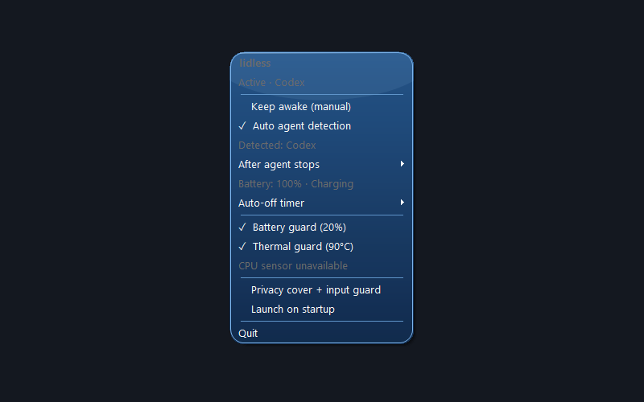

# lidless for Windows



**Keep local coding agents running while your Windows laptop lid is closed.** Lidless lives in the system tray, so the controls are one right-click away.

**[Download the Windows installer](https://github.com/soulflowxd/lidless/releases/latest/download/lidless-Setup.exe)** · **[Download the portable EXE](https://github.com/soulflowxd/lidless/releases/latest/download/lidless.exe)**

**[Windows install guide on Publik](https://publikhq.com/lidless-app/install/windows)** · **[Windows listing](https://publikhq.com/lidless-app)**

**On a Mac?** [Get Lidless for macOS on Publik](https://publikhq.com/lidless). It is a separate macOS app based on the original project; this repository builds the Windows version.

## At a glance

- **Tray-only controls:** right-click the icon for Keep awake, timers, guards, startup, and Quit.
- **Agent aware:** stays awake for active local Codex or Claude Code turns, then waits the delay you choose before restoring normal lid behavior.
- **Safety checks:** low-battery and CPU-temperature guards pause the keep-awake request when needed.
- **Optional privacy cover:** show a blue Windows 7-inspired screen over the desktop while a PIN blocks ordinary physical keyboard and mouse input. Compatible agents can keep using the unlocked desktop.
- **Two ways to get it:** an installer and a portable EXE, both linked above.

Lidless is a tray-only Windows app inspired by [Lidless](https://github.com/Blueturboguy07/Lidless). It temporarily sets the active power plan's lid-close action to **Do nothing** and asks Windows to stay awake while work runs. It restores the saved AC and battery lid actions when you turn it off or quit. A watchdog restores them if the tray app exits unexpectedly.

## Windows setup

1. Download **lidless-Setup.exe** for a normal installation, or **lidless.exe** for a portable copy. Windows 10/11 x64 is supported. The installer needs no administrator permission. Keep the portable EXE in a permanent folder if you enable startup.
2. Open lidless. Find its icon in the notification area beside the clock; click **^** if it is hidden. Right-click for the menu. There is no separate settings window. Choose **Quit** there to exit and restore normal lid behavior.
3. Turn on **Keep awake (manual)** for continuous operation, or choose an **Auto-off timer**. The timer ends only your manual request. Turn on **Auto agent detection** to keep the laptop running during a detected local Codex or Claude Code turn, even when manual Keep awake is off. The menu shows what is keeping lidless active.
4. Optionally select **Launch on startup**. This adds lidless to your Windows user startup entries. For the portable copy, move the EXE to its permanent location first.
5. Windows may need permission to change the lid action for the active power plan. If lidless reports a power-setting error, check Windows power settings and any organization policy. Test briefly with the lid closed before leaving long work unattended. Keep vents clear.

The **Battery guard** pauses lidless at 20% or less when unplugged and resumes when power is safe. The **Thermal guard** pauses at a measured CPU temperature of 90°C and resumes at 80°C. A CPU sensor might be unavailable on some hardware; the menu says so and lidless cannot apply the thermal cutoff without a reading. Battery and thermal guards take priority over manual and agent requests.

Auto agent detection checks local Codex and Claude Code session files about every 15 seconds and expires stale activity after 10 minutes. It detects active local turns, including Claude Code in the desktop app when it writes a local journal. It cannot reliably detect remote/cloud agents or ordinary Claude chat. Use manual Keep awake for those. Detection reads only local session status; it does not upload chats.

Use **After agent stops** to choose how long lidless stays active after the last detected turn ends (immediately, 1, 5, 10, 15, 30, or 60 minutes). The default is 5 minutes. A new active turn cancels the countdown. When the delay ends, lidless restores the normal lid action; Windows then decides whether to sleep under your power settings.

## Input guard (optional)

While lidless is keeping the laptop awake, choose **Privacy cover + input guard** from the tray menu. The first use asks you to set a PIN or password of at least four characters. An original blue screen inspired by the Windows 7 sign-in layout covers all connected displays. Press **Enter** (or **Ctrl+Alt+Shift+U**), type your PIN or password, and press Enter to restore your desktop. Ordinary physical keyboard and mouse input is filtered while many software-injected agent actions can continue. The guard turns off and asks Windows to lock if lidless stops keeping the laptop awake; its watchdog also asks Windows to lock if the tray app exits unexpectedly.

If you already set a longer password, choose **Change input guard PIN** while the guard is off, enter the old password, and set a four-character or longer PIN.

**The cover and input guard are convenience features, not a secure Windows lock.** The desktop remains unlocked. Ctrl+Alt+Del, other software, elevated processes, and some devices can bypass the guard. The cover is omitted from compatible Windows screen capture so screenshot-based agents can still see the desktop; this also means screen sharing or recording software may reveal it. Some agents use input methods that may be filtered or may target the cover, so test your agent before relying on this mode. Do not use it to protect sensitive data from someone with physical access.

## Closed-lid behavior

While active, lidless requests that Windows avoid idle sleep; the display may turn off. Windows policy, firmware, or hardware may still override the lid setting, so test on your laptop. Closing the lid does not lock Windows; press **Win+L** first if you want it locked. If you switch power plans while lidless is active, lidless restores the original plan it changed and leaves the new plan alone.

## Build locally

Install the .NET 8 SDK and run on Windows:

```powershell
dotnet publish src/lidless/lidless.csproj -c Release -r win-x64 --self-contained true -p:PublishSingleFile=true -p:EnableCompressionInSingleFile=true -o dist
```

The portable app is `dist/lidless.exe`. [Inno Setup 6](https://jrsoftware.org/isinfo.php) builds the installer from `installer/lidless.iss`; GitHub Actions builds and publishes both files.

## Licensing

From v0.4.0, original lidless code and artwork are under [PolyForm Noncommercial 1.0.0](LICENSE): commercial use needs separate permission. This does not revoke the MIT grants already published for v0.3.0 and earlier; see [the previous license](LICENSES/lidless-through-v0.3.0-MIT.txt). The inspiring project is separately MIT licensed. LibreHardwareMonitorLib is [MPL-2.0](THIRD_PARTY_NOTICES.md). See [NOTICE.md](NOTICE.md) for details.
